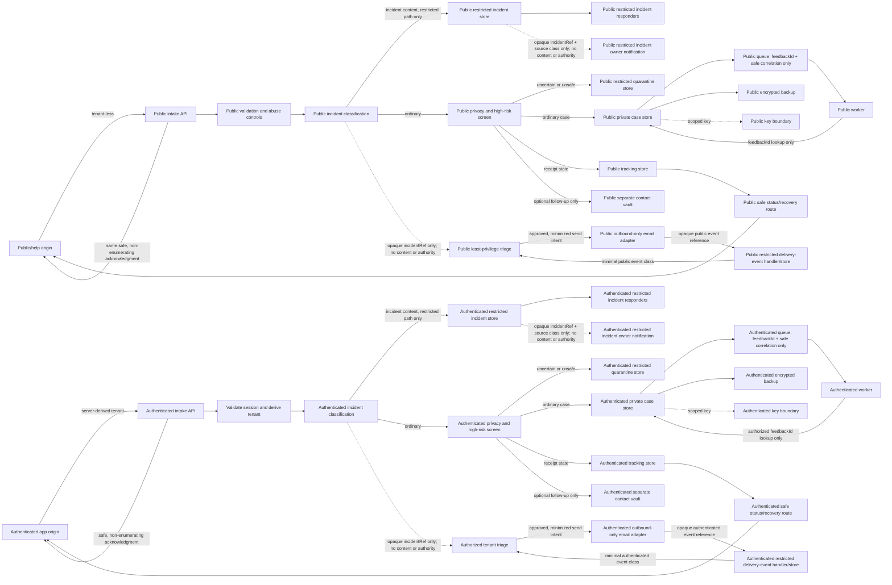

# Feedback platform, vendor, residency, email, and cost decision

## Status and authority

- **Status:** Draft for Cyrus decision; no provider, region, sender, spend, or
  activation is approved
- **Decision issue:** [#157](https://github.com/Jamula/Andreja/issues/157)
- **Parent framework:** [Feedback and support](feedback-support.md)
- **Privacy dependency:** [Feedback privacy, retention, and data-subject rights](../legal/feedback-privacy-retention-dsr.md), issue [#155](https://github.com/Jamula/Andreja/issues/155)
- **Security dependency:** [Feedback security, abuse, and incident routing](feedback-security-abuse-incident-routing.md), issue [#156](https://github.com/Jamula/Andreja/issues/156)
- **Cost baseline:** [Andreja cost model](../cost-model.md)
- **Accountable owner:** Jett Reno
- **Cost co-lead:** Quark
- **Required reviewers:** Spock, Tuvok, Deanna Troi, Sarek, Guinan, and Data
- **Decision authority:** Cyrus Jamula
- **Evidence reviewed:** 2026-10-10

This package compares paper options and proposes an operationally bounded
topology. It does not authorize an account, subscription, free tier, trial,
contract, domain, DNS record, sender, spend, collection, publication,
deployment, external email, support commitment, or launch. The only real
Phase 0 cloud-infrastructure budget remains **$0**.

Issue state, PR merge, and specialist verdicts do not approve this package.
Only Cyrus's explicit recorded `APPROVE`, `AMEND`, or `REJECT` decision in
#157 can do so. Even an approval here is not the separate bounded Evidence
Authorization required in #158.

## Decision requested

Review the candidate topology, provider shortlist, outbound-email posture,
staging inventory, and cost controls below. A provider and operating region
cannot be selected until the approved #155 policy and #156 security controls
are available, the deployment jurisdiction and controller are named, provider
terms are checked against those policies, Quark records a priced budget
recommendation, required specialists record their reviews, and Cyrus decides.

No Phase 1B funding request is submitted in this draft. There is no usable
numeric 14-day spend cap yet: the required operating region, account class,
database/queue SKUs, backup settings, support plan, email provider, and Quark's
unit-price review are unresolved. An unpriced cap or provider default must not
be passed to #158 as a budget. If any of these inputs remains unknown, the
provider-backed exercise is a no-go; the local/paper test path remains usable.

## Constraints inherited from the approved framework

The Phase 0 [framework](feedback-support.md) fixes the following product
boundaries; this package does not reopen them:

- Keep feedback private until screening, sanitization, exact publication
  preview, and separate publication consent are complete.
- Keep public tenant-less intake separate from the authenticated app data
  plane. Do not accept, derive, or partition public records by a tenant ID.
- Use a safe non-email status and rights route. Email is optional, outbound
  only, and never the sole status, verification, or data-rights path.
- Keep attachments, inbound email, live chat, marketing, reminders, tracking
  pixels, and product messaging out of scope.
- Do not put case text, diagnostics, contact addresses, tenant identifiers,
  receipt secrets, private issue links, or sensitive classifications into
  queues, email metadata, logs, traces, metrics, alerts, or GitHub artifacts.
- Keep Phase 0 research local or paper-only. Free tiers and trial accounts
  are not a workaround for the $0 cloud-infrastructure cap.

The proposed #155 package and its retention table remain unapproved. Cyrus
reopened #155 because the automatic closure on PR #172's merge did not meet
the explicit human-decision criterion; neither historical issue closure nor
that merge is approval. Cyrus directed Deanna Troi to amend and proceed on
transfer and hold-policy gaps on 2026-10-10. The latest inspected #193 state
(2026-10-11) is draft/open at head `7b2be3342f90b57334d23172d323dfa75fad5bff`;
the LF SHA256 of
`docs/legal/feedback-privacy-retention-dsr.md` at that head is
`97258a63859e3eff0209088ecf6aa1b3e40d5aa52809e1116d81764e476058bf`,
replacing the previously cited `25b21c...` file hash. This draft is
**unapproved**. Its transfer and hold inventories below are requirements for
the #157 evidence map, not completed provider evidence, counsel advice, or
approval. The current expiry procedure still leaves a frozen minimum in place
after day 14 while labeling further retention unauthorized until a decision;
Sarek flags that post-deadline disposition for resolution. Do not treat it as
an approved hold rule or inherit any retention period until Cyrus explicitly
approves the revised #155 package.

The #156 proposal and its existing merged source (PR #177) are also
unapproved. Tuvok's proposed supplement in draft PR #194 adds verifier/
namespace, generation/nonce/idempotency, response/stub, boundary-key, and
abuse-evidence controls that must be reviewed before this topology can pass.
This document proposes no security verdict and does not assign runtime abuse
thresholds.

## Provider-neutral topology proposal

This diagram is a paper design, not a deployed system. Exact regions, products,
service identities, key custody, database isolation, retention, and
cross-region behavior remain subject to #155/#156 and Cyrus's decision.



Proposed invariants for specialist review:

1. Maintain separately deployed public and authenticated boundaries, with
   separate service identities, credentials, network rules, queues, workers,
   datastore privileges, incident/quarantine stores, access roles, and backup
   scopes. Do not share a worker, service identity, queue, or privileged
   operator path across them.
   The outbound email adapter, provider credentials, event receiver, and
   delivery-event store are also boundary-specific; neither provider callbacks
   nor internal event state may cross between boundaries.
2. Keep the public endpoint outside the Andreja tenant data plane. Derive an
   authenticated tenant only from a server-validated session; reject
   client-supplied tenant or principal fields.
3. Persist an accepted case before enqueueing. Queue payloads contain only an
   internal feedback identifier and content-free correlation metadata.
   Workers load data using narrowly scoped identities, with idempotent
   processing and a bounded failure path.
4. Separate the case record from the contact destination and receipt verifier.
   Protect contact and verifier material with distinct access grants and
   approved key boundaries; preserve contact-vault key custody separately
   from case and receipt/verifier custody. Exact key counts and implementation
   remain subject to #156. No contact destination is put on the queue.
5. Restrict triage, privacy/security review, operations, key administration,
   backup/restore, and aggregate reporting to separately authorized roles.
   Routine support does not browse a database or queue directly. Break-glass
   access is time-bound, purpose-bound, audited, and tested.
6. Encrypt in transit and at rest. Treat provider encryption as one control,
   not as a substitute for field minimization, application authorization, key
   custody/rotation, backup purge, or a restore-time deletion ledger.
7. Keep the durable record portable: versioned application schema, PostgreSQL
   logical export/import, documented migration steps, and a provider-neutral
   backup manifest. Use a queue adapter contract for delayed/retried delivery,
   but assume at-least-once delivery and enforce dedupe/idempotency in the
   application, not in provider-specific FIFO behavior.
8. Keep blobs/object storage out of v1 unless a separately approved data class
   requires it. Attachments remain disabled. If object storage is later
   approved, content-addressed encrypted objects and deletion tombstones must
   export with a manifest and be purged with the source.
9. The provider-specific key-management service is not portable. Before any
   external provider is activated, #156 must approve a key generation,
   wrapping, custody, rotation, revocation, backup, restore, and exit method
   that does not falsely assume provider-managed key material can be exported.
10. Use the local OCI container plus PostgreSQL reference path as the
    portability/conformance baseline. Provider-specific SDKs stay in narrow
    adapters; the domain contract does not expose vendor resource identifiers,
    queue semantics, or email APIs.

The proposed topology is intentionally stricter than a shared service with
tenant tags. Tuvok and Deanna must confirm that the actual isolation, transfer,
hold, and recovery controls satisfy their packages before Cyrus considers it.
The minimum receipt/stub behavior for accepted, quarantined, rejected,
duplicate, missing, and incident cases is not selected here. Keep any new
receipt/stub persistence disabled until #155 approves its purpose, data class,
and retention and #156 approves the non-enumerating state/response contract.
Do not add a provider-side copy or infer acceptance from the queue response.

## Provider and vendor comparison

The following are research candidates, not selections or endorsements. The
primary-source register records the official documentation and published
pricing pages checked on 2026-10-10. Vendor privacy statements and subprocessor
registers are live documents; save a dated snapshot for the exact services and
contract before a later activation decision. A region selector alone is not
proof that support access, control-plane metadata, telemetry, events, keys,
replicas, or backups stay in-region.

### Hosting and persistence candidates

| Candidate | Service mapping and published cost drivers | Residency, deletion, and subprocessors | Security, access, portability, support, and limits | Current disposition |
|---|---|---|---|---|
| **Self-hosted OCI + PostgreSQL** | Container/runtime hours and host capacity; PostgreSQL CPU/RAM/storage/backup; queue operations or database-backed queue; encrypted backup bytes; key custody; outbound bandwidth. No cloud unit price is implied. | The operator chooses the host, storage and backup destination, but is responsible for physical location, onward transfers, subprocessors, deletion, restore tombstones, and evidence. No specific operator, region, processor, or contract is selected. | Strongest fit to the existing OCI/PostgreSQL portability direction. Operator owns patching, access reviews, key rotation, backup restore, failure response, and cancellation. Queue and mail adapters still need conformance tests. Operator-console accessibility, support coverage, capacity and actual infrastructure cost are unmeasured. | **Local/paper baseline only.** A real self-hosted staging environment still requires an approved host, numeric budget, and #158 authorization. |
| **AWS** | Candidate mapping: RDS for PostgreSQL, SQS, S3 only if approved, KMS; SES for outbound mail. Pricing drivers include database instance-hours, provisioned storage/backups/IO, SQS API requests and data transfer, S3 storage and operations, KMS key-months and requests, egress, and SES messages/recipient and optional features. See [RDS pricing](https://aws.amazon.com/rds/postgresql/pricing/), [SQS pricing](https://aws.amazon.com/sqs/pricing/), [S3 pricing](https://aws.amazon.com/s3/pricing/), [KMS pricing](https://aws.amazon.com/kms/pricing/), and [SES pricing](https://aws.amazon.com/ses/pricing/). | Selectable service regions do not settle transfer or support-access rules. RDS backup settings, replication, logging and queue event destinations must be enumerated. SES documentation describes event publishing; retention of any content/event copies and deletion obligations must be verified against the chosen configuration and contract. Review the live [AWS DPA](https://aws.amazon.com/legal/data-processing-addendum/) and [subprocessor register](https://aws.amazon.com/compliance/sub-processors/); exact applicable entities and locations remain unrecorded. | IAM and key controls are product-specific and require least-privilege role mapping, admin/break-glass evidence, access-log retention and restore tests. SQS delivery semantics and AWS resource identifiers require an adapter; PostgreSQL logical export remains the database exit path. AWS quota values are account/region dependent and must be checked without requesting an increase. Support tier, response commitments, accessibility evidence, exact cancellation and residual backup deletion are unverified. | **Candidate only.** Do not create an account or choose a region. Obtain Quark's priced 14-day quote and specialist contract/access/transfer review first. |
| **Microsoft Azure** | Candidate mapping: Azure Database for PostgreSQL Flexible Server, Queue Storage (or another specifically approved queue), Blob Storage only if approved, Key Vault. Pricing drivers include database compute-hours/storage/backup, storage operations and capacity, key operations, networking/egress and support. See [PostgreSQL pricing](https://azure.microsoft.com/pricing/details/postgresql/flexible-server/), [Queue Storage pricing](https://azure.microsoft.com/pricing/details/storage/queues/), [Blob pricing](https://azure.microsoft.com/pricing/details/storage/blobs/), and [Key Vault pricing](https://azure.microsoft.com/pricing/details/key-vault/). | Flexible Server backup geo-redundancy and restore behavior require an explicit choice; do not enable paired-region replication by default. Queue message TTL and retention configuration must be explicitly bounded. Microsoft's [data residency overview](https://azure.microsoft.com/explore/global-infrastructure/data-residency/), [DPA](https://www.microsoft.com/licensing/docs/view/Data-Protection-Addendum-DPA), and current subprocessor disclosures must be reviewed for the actual services, regions, support access and transfer pathway. Exact entities/countries and post-termination deletion are not established here. | Azure RBAC, Key Vault and service identities need exact least-privilege, key custody, administrative access and restore evidence. Queue Storage has different visibility/TTL semantics from SQS/Pub/Sub; isolate those in an adapter and test replay/idempotency. PostgreSQL logical export is the database exit path. Exact support tier, service quotas, accessibility, cancellation, and deletion of provider-managed backup copies remain unverified. | **Candidate only.** Region and backup configuration cannot be inferred from an Azure-wide residency page. No account or resource creation. |
| **Google Cloud** | Candidate mapping: Cloud SQL for PostgreSQL, Pub/Sub, Cloud Storage only if approved, Cloud KMS. Pricing drivers include database vCPU/RAM-hours, storage/backups, Pub/Sub throughput/retention, object storage operations/capacity, key versions/operations, networking/egress and support. See [Cloud SQL pricing](https://cloud.google.com/sql/pricing), [Pub/Sub pricing](https://cloud.google.com/pubsub/pricing), [Cloud Storage pricing](https://cloud.google.com/storage/pricing), and [Cloud KMS pricing](https://cloud.google.com/kms/pricing). | Pub/Sub message storage policies can restrict message storage/processing regions, but do not apply to all topic metadata or IAM data. Cloud SQL backup/restore location, support, logs and other metadata need separate evidence. Review the current [Google Cloud DPA](https://cloud.google.com/terms/data-processing-addendum) and [subprocessor list](https://cloud.google.com/terms/subprocessors); exact service-specific entities, locations, support access and deletion at termination remain unrecorded. | IAM, Cloud KMS, backup and restore roles must be mapped to approved security controls. Pub/Sub differs in retention, ordering and acknowledgment behavior from other queues; do not let those semantics escape its adapter. PostgreSQL logical export is the database exit path. Exact support terms, quotas, accessibility, cancellation and backup-deletion evidence are unverified. | **Candidate only.** A message storage policy is not whole-service residency. No account or resource creation. |

For all hosted options, processor qualification is blocked until the chosen
contract covers documented instructions, approved subprocessors and change
notice, support access, incident notification, rights assistance, deletion or
return at termination, transfer protections, and audit evidence. Sarek must
review the exact applicable terms. Data must separately verify user-facing
accessibility and failure behavior; provider compliance badges are not test
evidence.

### Transactional email candidates

| Candidate | Purpose, delivery, quotas, and price evidence | Residency, data retention, access, and subprocessors | Lock-in, support, and disposition |
|---|---|---|---|
| **Amazon SES** | Supports outbound API/SMTP sending and event publishing for send/delivery/bounce/complaint-related activity. The [SES pricing page](https://aws.amazon.com/ses/pricing/) is the source for current per-message/recipient, attachment and optional-feature charges; pricing varies by service option/region. Per-account, per-region sending quotas must be read from the selected account; do not request an increase for staging. SPF/DKIM/DMARC are customer-owned DNS/authentication work; AWS explains alignment in its [DMARC guide](https://docs.aws.amazon.com/ses/latest/dg/send-email-authentication-dmarc.html). | SES region and event destination configuration do not alone establish message-content or event retention. Exact message handling, event storage, account support access, and deletion need written/configuration evidence. Review AWS's current DPA and subprocessor register above. SES suppression behavior and its scope must be verified; never assume the provider's suppression list replaces Andreja's complaint handling. | Lower-volume published costs are usage-based, but connected SNS/EventBridge/CloudWatch, storage, transfer, and account/support charges also need inclusion. SES-specific event payloads and quota controls require an adapter; delivery is not equivalent to user verification. Cancellation requires disabling send identities/credentials, deleting event destinations and provider configuration, and reconciling provider-held data. **Candidate only; actual cost and service terms pending Quark and reviewers.** |
| **Postmark** | Transactional API/SMTP, message streams, and delivery/bounce/complaint events are documented. Its [official pricing page](https://postmarkapp.com/pricing) lists a paid Basic tier at **$15/month for 10,000 emails**, with overage pricing shown there; the free plan is prohibited for this work. Event/webhook behavior and account quotas must be tested against a paid contract before consideration. DNS authentication and sender validation remain owner-controlled. | Postmark's [EU data-protection page](https://postmarkapp.com/eu-privacy) says its primary servers are at a US data center and AWS and that it has no current plan for EU servers; it provides a DPA and subprocessor listing. That is a material blocker if an approved residency/transfer rule requires EU processing. Its [activity-retention description](https://postmarkapp.com/email-analytics) says full message content and message history are stored for 45 days by default, configurable from 0 to 365 days via a retention add-on; confirm the exact selected setting, event coverage, purge behavior and contractual evidence. Access is limited by its described need-to-know policy; exact administrative-access records and contract terms still need review. | Vendor API, streams, and event schemas create lock-in; hide them behind an email adapter and store only minimized, content-free event state. Paid recurring minimums mean low staged volume still incurs a base fee. Support commitments, plan-specific quotas, accessibility evidence, cancellation notice and post-cancellation deletion remain unverified. **Candidate only; US hosting and 45-day default are explicit privacy/transfer concerns, not accepted terms.** |

No provider is preferred until its evidence passes the same privacy, security,
support, accessibility, deliverability, cost, and exit criteria. A provider
that cannot satisfy an approved #155 or #156 rule is removed from the viable
set; cost or convenience cannot waive the conflict.

## Residency, data flow, access, and deletion evidence

The specific deployment jurisdiction and data controller are not yet named.
The proposed #155 policy requires that processors, independent recipients,
transfer routes, locations and purposes be reviewed and that holds be scoped;
Deanna is amending those requirements. For each chosen vendor and service,
the decision record must therefore identify:

- Data class (case body, contact destination, consent/receipt, verifier,
  queue metadata, delivery event, abuse signal, key material, backup, audit
  record, support ticket).
- Storage and processing regions for primary data, replicas, backups, queues,
  logs/telemetry, email events, keys, control plane, and support access.
- Any onward transfer country, recipient legal entity, purpose, transfer
  mechanism, notice/change period, and approved or rejected subprocessor.
- Roles that can access each class, including provider support, break-glass,
  operator administrator, caseworker, privacy/security reviewer, backup
  operator, and finance/usage reviewer; evidence of authentication, least
  privilege, time-bound elevation and access audit.
- Controller/processor role, exact DPA and service terms, incident notice,
  rights assistance, retention and deletion terms, export/return at
  termination, and contract cancellation/renewal.
- Exact deletion propagation across active records, contact vaults, receipts,
  indexes, caches, queues/dead letters, retries, email payloads/events,
  backups, provider logs, and restores. Each destination needs a scoped
  completion receipt; failed propagation blocks a completion claim.
- A separately inventoried hold record: authorized owner, legal/security
  category, exact fields and systems, start, review date, end condition,
  access list, decision reason, partial-deletion behavior and safe appeal/
  response. Holds must not silently become an indefinite backup or case copy.

No value is adopted for private, contact, consent receipt, delivery event,
quarantine, abuse evidence, aggregate, or hold retention until #155 is
explicitly approved. The implementation must apply its exact approved
durations and exceptions, and #156 must demonstrate that content remains
restricted while deletion, hold, backup, or restore work is pending.

The providers' public statements and links are research pointers, not contract
approval. Region-only marketing language, a generic DPA, a certification, or
an unbounded subprocessor page is insufficient by itself.

### Required transfer record per candidate

Before any candidate can be recommended, its record must satisfy the
transfer-evidence fields proposed in #155 v1.1 (unapproved):

| Field | Required evidence |
|---|---|
| Operator and scope | Named operator and deployment jurisdiction; exact service, environment, purpose, release and record scope |
| Recipient | Recipient legal entity and controller/processor role; approved purpose, fields/classes, source and destination systems, endpoint, disclosure scope |
| Full geography and access | Every processing, storage, backup, remote-access and onward-transfer country; all subprocessors/recipients and access roles; dated end-to-end flow map |
| Terms and deletion | Contract/terms version and effective/expiry dates; subprocessor-list version and change-notice terms; provider privacy-notice version; deletion/return and rights-assistance evidence |
| Legal review | Dated counsel applicability assessment; transfer mechanism when required; exact scope and validity; risk assessment, supplementary safeguards and unresolved limitations |
| Governance | Named owner; review references and date; next review within 90 days; expiry; explicit approval bound to this exact flow and release; block state |

A service's selected region, encryption statement, brand, consent receipt, or
generic DPA does not fill missing geography or transfer fields. Unknown
countries, recipient roles, subprocessors, support routes, or backup locations
block that flow. A legal or privacy approval for one service does not
automatically cover another service, environment, or release. GitHub remains a
separately assessed independent controller for a consented public artifact.

### Required hold record and held-content separation

Each candidate must support the separate hold inventory proposed in #155 v1.1
(unapproved): hold ID; restricted source and DSR references; legal/security
category; purpose and conditional basis/counsel reference; authorizer and
owner; exact fields/classes/systems; start, review and expiry; end condition;
access list; safe reason; renewal and release decisions/times; and
partial-deletion/propagation receipts.

Hold metadata must remain separate from isolated held content. The v1.1 draft
proposes authorization/review no longer than 90 days unless counsel records a
binding preservation duration, prohibits automatic renewal, and retains
metadata for three years after release or final held-scope deletion and
propagation resolution (whichever is later), subject to a counsel-reviewed
exception. These are proposed policy values only: do not configure or use them
until Cyrus explicitly approves #155 and the final scope is checked with
counsel. The provider must demonstrate partial deletion around the held scope,
access restriction during a hold, review/expiry enforcement, release and
purge propagation, and safe appeal evidence.

## Sender identity and DNS plan (no DNS changes)

1. Cyrus/domain owner first selects and verifies an already-owned domain after
   #155/#156 review. Do not register a domain, change root-domain records, or
   create DNS records in this issue.
2. For a later isolated exercise only, reserve a dedicated child domain such
   as `feedback-staging.example.invalid` as a documentation placeholder. Use
   no production sender, domain, bounce route, credential, or recipient.
3. The selected provider must supply its current sender-verification and
   authentication requirements. The domain owner reviews the exact SPF
   mechanism and merges it into the domain's existing single SPF policy;
   publish provider-specific DKIM selectors with a rotation/revocation owner;
   and publish an aligned DMARC policy for the child domain. Do not publish
   duplicate SPF records or copy provider-supplied values into production DNS.
4. Before any controlled message is sent, verify From-domain alignment with
   DKIM and, where usable, SPF; DMARC must pass on a captured synthetic
   message at the verifier-controlled mailbox. Record the DNS snapshot,
   selector/key owner, validation result, expiry and removal evidence.
5. Use an honest, non-production display identity, equivalent plain-text and
   accessible HTML, stable safe subjects, no pixels/click tracking, no case
   body/diagnostics/private URLs/tenant names/classifications, and no
   recipient address in tags or telemetry.
6. Restrict recipients to the future #158 verifier-controlled allowlist.
   Keep safe status and DSR available through the non-email route if sending,
   verification, or a return address fails.
7. Remove the child-domain records and sender authorization at teardown;
   revoke provider/API credentials and suppression/webhook configuration.
   Domain or sender identity changes require a new authorization.

This is a plan only. Exact DNS values, domain ownership, sender address,
recipients, and any live deliverability result are deliberately absent.

## Cost model, staging caps, and cancellation

### Phase 0

**Cloud-infrastructure cap: $0.** No provider accounts, subscriptions,
free-tier or trial resources, DNS changes, domain registration, paid email,
public hosting or live mail. Pricing research uses public documentation only.
Development AI credits and professional-services expenses remain separate
envelopes as described in `docs/cost-model.md`.

### Cost equation and measurable units

Quark must calculate the proposed 14-day total from the selected region and
public provider price source, excluding free-tier offsets and discounts:

```text
14-day total =
  runtime instance-hours x rate
  + managed database instance-hours x rate
  + database provisioned GB-month x rate
  + retained backup GB-month x rate
  + queue operation/byte/retention units x rate
  + object storage GB-month and request units x rate
  + key-months and cryptographic operation units x rate
  + ingress, NAT, inter-zone, and internet-egress units x rate
  + log/metric/alert ingestion and retention units x rate
  + email message/recipient/attachment units x rate
  + account, support-plan, domain, tax, and other fixed charges
```

Each estimate records service, SKU/tier, region, currency, billing granularity,
quantity, unit rate, source URL and retrieval date, included/overage threshold,
tax treatment, uncertainty, minimum commitment/term, partial-period proration,
early-cancellation charge, and a higher-than-forecast stop. Quark must
separately report fixed minimums and variable ceilings, including support and
other ancillary charges. Budgets/alerts are detective only; the actual hard
stop is enforced before resource creation or message send, with an independent
test that the stop works. Before any future authorization, document the
meter-reading and reservation cadence, maximum provider-metering delay, and
fail-closed behavior for stale or unavailable usage; reconcile delayed usage
before the next billable action. No unmetered fallback or automatic quota
increase is allowed.

### Proposed synthetic exercise bounds (not runtime abuse policy)

These are Jett's proposed *exercise* quantities for a future #158 decision.
They are not approved public-intake rate, payload, availability, or abuse
thresholds; those remain with #156, Data and Cyrus.

| Dimension | Proposed maximum for one later exercise |
|---|---:|
| Duration | 14 calendar days from authorization issuance; deny new work after expiry |
| Isolated feedback boundaries | 2 maximum (public tenant-less and authenticated, only if both are explicitly in scope) |
| Service/API and worker instances | 1 per role per boundary; no autoscaling |
| Database instances | 1 per boundary; no read replicas, HA, or cross-region replica |
| Queues | 1 per boundary, with no payload beyond `feedbackId` and safe correlation metadata |
| Key boundaries | Per-boundary, per-data-class key inventory; keep contact-vault custody separate from case and receipt/verifier custody. Exact key counts, KMS/HSM mapping, and recovery method require #156 approval. |
| Backup snapshots | At most 1 per database, encrypted, same approved region, auto-expiring at exercise end; a #155-approved deletion/tombstone schedule still governs |
| Synthetic records | 25 per boundary (50 total), with generated data only |
| Test email | 100 messages total, at most 2 verifier-controlled recipients, no attachments, no live-user addresses |
| Public exposure | No general public intake/launch endpoint or public search indexing; only access controlled as #158 authorizes |
| Regions | 1 specifically named region per provider; no cross-region replication, backup, or failover |
| Cloud spend | **Not yet priced or requested.** Future numeric cap must be quoted by Quark and approved by Cyrus in #158 before provisioning. |

The 100-message cap is a test-volume ceiling, not permission to send. A
provider's account quota or its free tier cannot substitute for the #158
allowlist or numeric budget. If the chosen provider has a fixed minimum or
unmetered ancillary service, include that entire charge in the quote or reject
the option.

### Reconciliation, hard stop, and exit

- Reserve cost before every billable resource or external send. Stop when
  actual or forecast consumption reaches the later Cyrus-approved cap; alert
  Quark and Cyrus earlier at a threshold Quark proposes and Cyrus records.
- Reconcile metering to the provider statement at exercise close; record
  price changes, missing usage, and mismatches as blockers. Do not present
  alert configuration as a billing cap.
- Record named owner, renewal/usage trigger, cancellation path/notice,
  lower-cost local/fake fallback, and link to the approved cost decision for
  every paid commitment before purchase. No auto-renew or quota increase.
- At expiry or revocation, deny requests, disable public/test ingress and
  sender, cancel or delete resources, revoke provider/service identities and
  keys, purge queues/stores/events and permitted backups, remove DNS records,
  collect deletion receipts, reconcile spend, and report any vendor-held data
  that cannot be immediately purged. A failure leaves the exercise blocked
  and escalates; it must not be reported as successful teardown.

## Bounded staging inventory proposal for #158

Nothing in this inventory has been provisioned or authorized. Before Cyrus
issues a future #158 authorization, the record must replace each bracketed
field with a specific value and include its source/owner:

| Allowlist item | Proposed inventory shape | Required evidence before authorization |
|---|---|---|
| Provider and account | `[provider]`, `[non-production account/project/subscription ID]`, segregated from production | Account owner, no production credentials/data, billing owner, policy controls and resource quota |
| Region and network | `[one named provider region]`, isolated project/VPC/subnets, restricted ingress/egress | Residency/transfer review, no cross-region features, firewall and outbound-destination test |
| API/worker | One immutable OCI digest, one API and one worker per authorized boundary | Release commit+digest, role/identity map, no autoscale, TTL tags/deny-after-expiry |
| Data stores | Separate case, tracking/receipt, and contact-vault stores per boundary; no cross-boundary shared identity | Field/classification schema, encryption/key inventory, access log and deletion test; preserve separate contact-vault custody |
| Queue | One separate queue per boundary; identifiers only | Retention/TTL, max message/size, retry and dead-letter rules from approved #156; purge receipt |
| Queue-recovery/dead-letter store | If queue-recovery testing is in scope: one isolated store per boundary, synthetic queue metadata only, no case body/contact/verifier; `[authorized maximum records and bytes]`. This is not the privacy-screening quarantine store. | Name the boundary-specific, least-privilege incident role(s) in private authorization; record TTL, access log, purge receipt and any separately allowlisted backup scope. Exclude content-bearing privacy-screening quarantine unless it is separately inventoried and approved under #155/#156; otherwise keep that evidence blocked. |
| Incident evidence store | If incident-response testing is in scope: one isolated restricted store per boundary with separately approved fields/classes; staging uses generated synthetic incident fixtures only; `[authorized maximum records and bytes]` | Name boundary-specific responder/security roles in private authorization, with audited access; record retention/TTL, one-way notification fields and purge receipt. No backup by default; any backup requires an explicit allowlist, #155 scope and deletion/restore evidence. Otherwise exclude the scenario and keep its evidence blocked. |
| Delivery callback ingress and event store | One authenticated callback endpoint and restricted event store per boundary; opaque provider event reference and minimal event class only; `[authorized maximum records and bytes]` | #156-approved callback authentication/replay/deduplication controls, boundary-specific credentials and access roles, retention/TTL, deletion propagation, and purge receipt. No backup by default; an authorized restore test must explicitly allowlist its scope. |
| Backup | One encrypted same-region snapshot per database, if needed for the authorized restore test | Approved duration under #155, automatic expiry, key recovery, tombstone replay and purge evidence |
| Sender and DNS | Dedicated non-production child domain(s), exact SPF/DKIM/DMARC record set, and a separate provider sender identity/credential set per boundary | Domain-owner approval, boundary-specific validation and alignment test, recipient restriction, removal plan; no production-domain root changes or shared sender credentials |
| Recipients and messages | Maximum 2 verifier-controlled recipients and 100 generated test messages | Named recipient custody in the private #158 authorization only; safe templates, no personal/case content |
| Observability | Content-free logs/metrics/alerts only; no raw destination, feedback body, verifier, token or provider error body | Canary tests, access control, retention/purge mapping, no third-party telemetry until separately approved |
| Spend | `[numeric USD cap, provider quote, service/unit table, billing owner]` | Quark recommendation, pre-action reservation/hard stop test and Cyrus's explicit #158 cap |
| Expiry and teardown | Start time; expiry by day 14; automatic denial; named operator/custodian | Tested teardown workflow, cancellation notice, DNS/key revocation and scoped purge receipts |

The actual account identifiers, recipient list and credentials belong only in
the private authorization/configuration system, never in this public
repository document, issue, or PR. The public record contains only redacted
references and content-free completion evidence.

## Local/paper failure-test plan

Data owns exact executable scenarios and evidence; this plan is the
provider-neutral platform input. It has not been executed against a live
provider. For each test, use deterministic local adapters and generated
records. A test result that cannot be exercised locally is `Blocked` or
`Unavailable`, never a pass.

| Scenario | Local/paper setup | Required result/evidence |
|---|---|---|
| Provider outage and acceptance boundary | Stub queue, database, key provider, and each boundary-specific mail adapter independently and in combination, both before and after durable case commit | Before durable commit, return a safe non-enumerating failure and never claim `Received`; after commit, keep the accepted record and approved safe status despite downstream failure. Retries are bounded and idempotent; no silent loss or duplicate transition; no unapproved response stub is persisted |
| Public/authenticated isolation | Submit generated requests across both boundaries, including forged tenant/principal fields and cross-boundary callback references | Public intake creates no tenant-plane artifact; authenticated intake derives tenant only from the validated server session. Stores, queues, workers, service identities, callback credentials, event stores, and operator paths remain boundary-specific; no cross-boundary read, write, or event routing |
| Queue recovery | Pause worker, fill the proposed test queue to its later authorized cap, restart worker, replay a message and deliver the same event twice | No cross-boundary read/write, duplicate lifecycle transition, raw content in queue, or unbounded backlog; if the quarantined/dead-letter path is exercised, use only its separately allowlisted boundary store and roles; result is owner-visible and purgeable |
| Quarantine and incident evidence | Keep the scenario `Blocked` until #155/#156 and #158 authorize the boundary-specific stores, access roles, record/byte/retention ceilings, and backup scope; then inject synthetic failures and exercise allow/deny, cap, TTL, purge, and (only if allowlisted) restore cases | Only authorized synthetic fixtures enter restricted incident storage; no real case content, contact, verifier, credentials, cross-boundary access or unbounded evidence. Access is role-checked and audited; over-cap and unconfigured cases fail closed; deletion and any authorized restore produce scoped receipts |
| Incident routing and one-way handoff | Inject a synthetic incident-class request in each boundary and separately fail its restricted incident store and owner-notification path | Restricted responders receive only their authorized scope; ordinary triage gets at most an opaque `incidentRef` and the submitter gets only a safe acknowledgment, never incident content or authority. No fallback to ordinary case/queue triage on store/alert failure; keep the route/evidence blocked and report only a non-enumerating outcome |
| Delivery reconciliation | Generate accepted, delayed, bounced, complained, suppressed and duplicate email events with fake provider IDs independently in each boundary | Each boundary authenticates its own provider events, deduplicates and maps only minimal status in its own event store; suppression blocks further sends; provider `delivered` never becomes user `Verified`; callback state cannot cross boundaries |
| Bounce/complaint and non-email recovery | Exercise absent, changed, bounced, complained-about, and suppressed destinations; attempt status, DSR, verification and reopen through the approved non-email route | Suppress further sends as required; do not reveal whether a record or destination exists; preserve safe status and rights access without relying on email. Exact proof, response and appeal behavior remains gated by #155/#156 |
| Email accessibility | Render equivalent plain-text and accessible HTML messages; exercise challenge and recovery with keyboard and assistive-technology-compatible local fixtures | Meaning and actions are equivalent; challenge, verification and recovery have accessible alternatives; no tracking pixel or inaccessible email-only path. This is a planned check, not a user accessibility result |
| Privacy and recipient control | Use only generated cases and verifier-owned test fixtures; attempt an unlisted-recipient send and include prohibited fields in a fake message/event | Deny before send; no case body, direct identifiers, tenant or secret in template, event, logs, traces, alerts or error body; record no personal destination in public evidence |
| Cost stop | Fake metering just below, at and above the later numeric cap; run concurrent resource-create and send requests; inject unknown price/usage | Reserve before action; exact approved threshold stops all billable work; race cannot overspend; missing metering, price, or reconciliation is fail-closed; alerts alone do not count as a stop |
| Residency/transfer boundary | Inspect generated IaC and resource configuration for primary/backup/log/queue/event/key region and subprocessors; attempt a disallowed region/transfer | Policy denies unapproved region/transfer; support and metadata paths are independently inventoried; no claim of residency based only on database region |
| Lifecycle and status audit | Replay authorized and unauthorized status, ownership, duplicate, delivery, verification and reopen transitions with generated identities | Only approved roles can transition state; audit is content-free and idempotent; delivery never implies verification; exact state, receipt and proof semantics remain blocked on #155/#156 |
| Observability and aggregate metrics | Inject synthetic sentinel values through each boundary's planned logs, traces, alerts, event stores and aggregate path; attempt a cross-domain join | No content, direct identifiers, pseudonymous references, destinations, verifiers or provider payloads leak; only approved thresholded aggregates are available. Group thresholds and retention remain unselected until #155/#156 approval |
| Deletion and restore | Create synthetic case/contact/receipt/queue/event/backup artifacts, delete under approved #155 policy, restore a test backup | Each destination returns a scoped receipt; tombstone replays before restored data is available; no deleted case/contact/secret resurrects; held fields remain narrowly restricted pending approved hold |
| Teardown/cancellation | Expire/revoke the exercise and simulate cancellation, purge, DNS and key-revocation failures | Endpoint denies new use; sender/credentials/keys/queues/stores are disabled or purged; failures stay open and block success; evidence includes content-free completion receipts and cost reconciliation |
| Portability/exit | Export synthetic PostgreSQL records, schema/migration version, safe queue state, and encrypted backup manifest; import into local OCI/PostgreSQL reference | Domain records and approved metadata restore without provider IDs; duplicate delivery remains safe; vendor keys are not presumed exportable; limitations and any user-visible loss are explicit |

### Planned coverage map to the 14 Phase 1B acceptance scenarios

This is a scope crosswalk, not an execution report. Every item remains
unexecuted against an exact release; rows marked outside the platform plan
remain blocked until #158 supplies the required functional, help, or runbook
evidence. A local/paper scenario cannot substitute for that evidence.

| #158 scenario | Related local/paper scenario or evidence owner | #157 status |
|---|---|---|
| 1. Tenant-less public receipt and boundary isolation | Public/authenticated isolation; teardown | Planned locally; exact-release evidence remains for #158 |
| 2. Authenticated consent preview and tenant isolation | Public/authenticated isolation; privacy and recipient control | Consent UX/evidence is outside this platform plan; blocked for #158 |
| 3. Default exclusions and safe error/log handling | Privacy and recipient control; observability and aggregate metrics | Planned locally; exact exclusion suite and approved #155/#156 fields remain for #158 |
| 4. Submitter/non-user rights, proof, conflicts, appeal and propagation | Deletion and restore; lifecycle and status audit | Proof, conflict and appeal behavior remains blocked on #155; exact-release rights evidence belongs to #158 |
| 5. Abuse, replay, injection, cost and accessible-alternative controls | Queue recovery; quarantine and incident evidence; cost stop; email accessibility | Planned only after #156 defines controls and #158 authorizes the exercise; no numeric runtime threshold is supplied here |
| 6. Dedupe before GitHub with independent tracking/follow-up/reopen | Queue recovery; delivery reconciliation; lifecycle and status audit | Platform replay plan only; application dedupe/publication tests remain for #158 |
| 7. Exact preview, publication consent, kill switch and incident recovery | No platform publication test; use the approved application/privacy/security acceptance suite | Outside this platform package; blocked on #155/#156 and #158 |
| 8. Private vulnerability and personal-data incident routes | Quarantine and incident evidence; teardown/cancellation | Restricted stores remain unapproved; exact private-route evidence belongs to #156/#158 |
| 9. External status, help, verification and reopen without repository access | Bounce/complaint and non-email recovery; delivery reconciliation | Planned route-availability checks; canonical help and exact proof flow remain for #158 |
| 10. Authorized lifecycle transitions, ownership, delivery and verification | Lifecycle and status audit; queue recovery; delivery reconciliation | Planned locally; exact transition contract remains gated by #155/#156 |
| 11. Minimal transactional email, accessibility, suppression, retention and cost | Delivery reconciliation; bounce/complaint recovery; email accessibility; cost stop | Planned locally; live sender, recipient and provider evidence remains unauthorized |
| 12. Thresholded aggregate metrics without identifiers or joins | Observability and aggregate metrics | Planned locally; privacy thresholds and exact-release evidence remain for #155/#158 |
| 13. Canonical accessible help/status/DSR/consent content | No platform content test; Guinan/#93 and #158 own the reviewed help evidence | Outside this platform package; blocked until version, accessibility, ownership and stale-link evidence is supplied |
| 14. Reviewed, exercised runbooks and blocking owners for unresolved failures | Teardown/cancellation; quarantine and incident evidence | Plan only; exact-release drills and residual-failure ownership remain for #158 |

Before any live exercise, Data must replace this planned crosswalk with
exact-release results and evidence for every applicable criterion, including
provider failure, queue recovery, delivery reconciliation, approved cost-stop
behavior, and complete teardown. No local result substitutes for the separate
#158 controlled exercise.

## Review and decision record

| Role | Required review | Status |
|---|---|---|
| Jett Reno | Platform topology, operational failure paths, portability and teardown | Draft recommendation only |
| Quark | Region/SKU quote, fixed/variable units, hard stop, cancellation, and cost cap | Pending; no priced recommendation or numeric cap |
| Spock | Architecture and boundary compatibility | Pending |
| Tuvok | Security, abuse, key, queue and staging controls | Pending; the bounded topology feedback has been incorporated; #156 and its supplement remain proposed/unapproved |
| Deanna Troi | Privacy, transfer, retention, recipient and hold alignment | Pending; #155 amendment in progress |
| Sarek | Legal/contract, role, transfer and jurisdiction review | Pending |
| Guinan | Intake/status/email workflow and non-email fallback | Pending |
| Data | Testability, failure evidence, accessibility and exact-release mapping | Pending |
| Cyrus Jamula | Explicit `APPROVE`, `AMEND`, or `REJECT` decision | Pending; no activation authorization |

## Open blockers and revision triggers

1. **#155 approval:** The proposed privacy package is not approved. Deanna's
   directed transfer/hold amendment and Cyrus's later explicit decision are
   prerequisites. Until then, residency, recipients, retention, deletion,
   holds and data transfer remain gates.
2. **#156 approval:** The proposed security package and Tuvok's proposed
   supplement are not approvals. Verifier/key namespace, idempotency,
   non-accepted response, abuse evidence, numeric controls, and exact
   boundary-level access remain blockers.
3. **Provider and legal evidence:** No jurisdiction, operating entity, region,
   account, contract, service plan, subprocessor snapshot, support path, or
   service-specific transfer evidence is selected.
4. **Cost recommendation:** Quark has not supplied a region/SKU quote or
   numeric 14-day cloud/email cap. This draft asks for no spend. An unpriced
   provider exercise is not eligible for #158 authorization.
5. **Sender authority:** No domain owner, approved child domain, sender
   identity, DNS records, provider key, or recipient allowlist is selected or
   authorized.
6. **Operational/review evidence:** No staging resource, live endpoint,
   external message, accessibility result, runbook drill, teardown receipt,
   or specialist verdict is claimed.
7. **Changed assumptions:** New jurisdiction, provider, service, data class,
   subprocessor, support pathway, backup mode, spend, scaling, or email purpose
   requires this comparison and relevant privacy/security decisions to be
   reopened before use.

Keep all affected routes disabled while a blocker remains. If a vendor cannot
evidence an approved requirement, remove it from consideration rather than
weakening that requirement.
