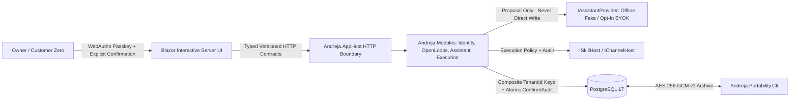

# Andreja: Project Origin, Architectural Evolution, and 15-Milestone Trajectory

> **Assessment timestamp:** `2026-11-25T08:16:39.737-08:00` (baseline `main` commit `5bf2ffcacdd19a9672eee7ef69d7be87e88c5187`)
>
> **Authority and boundary notice:** Only the last accepted [`docs/plan.md`](plan.md) revision recorded in [`ADR 0000`](adr/0000-plan-ratification.md) (`e2044133...` from [PR #202](https://github.com/Jamula/Andreja/pull/202) at [`861bff7c`](https://github.com/Jamula/Andreja/commit/861bff7c6d74be5a497e7a0f706a3a92bdae9ddc), not the pending proposed working hash `3e0c6b52...`) and the exact accepted revisions of Architecture Decision Records under [`docs/adr/`](adr/0000-plan-ratification.md) (such as [`docs/phase-1a/packet-decision-66.md`](phase-1a/packet-decision-66.md) for `ADRs 0001–0005`, excluding proposed editorial working-copy diffs) remain normative. This document is an explanatory historical and architectural reference guide. It does **not** amend `docs/plan.md`, approve pending plan or ADR proposals, ratify [`docs/charter.md`](charter.md) ([`ADR 0006`](adr/0006-charter-ratification.md) remains `Proposed`), ratify [`ADR 0012`](adr/0012-owner-device-content-encryption.md) (remains `Proposed; not ratified`), ratify [`ADR 0007`](adr/0007-test-framework.md) or [`ADR 0011`](adr/0011-default-branch-required-gates.md) (both remain `Proposed`), authorize external accounts, cloud infrastructure, or spend, or declare any phase exit complete.

---

## 1. Genesis: Why the Repository Was Created (`2026-08-22`–`2026-08-23`)

Andreja originated on `2026-08-22` under `@cyrusjamula`'s personal GitHub account (`cyrusjamula/Andreja`) with a pragmatic, personal mission: to assemble a coherent home for personal productivity tools, skills, and AI agents helping Customer Zero (`@cyrusjamula`) capture and follow through on personal projects, open loops, tasks, todos, and daily chores.

Existing consumer task, inbox, and assistant ecosystems forced an unacceptable trade-off: convenience required surrendering personal data ownership, enduring opaque retention or model-training policies, or letting engagement-driven cloud products monetize user attention. Customer Zero wanted an assistant that lowered administrative cognitive load while keeping personal context under explicit user control.

Within 24 hours (`2026-08-23`), that personal productivity workspace outgrew an ad-hoc collection of scripts and prompts:

1. **Canonical organization home ([#30](https://github.com/Jamula/Andreja/issues/30), [`docs/repository-migration.md`](repository-migration.md)):** `cyrusjamula/Andreja` transferred to the `Jamula` GitHub organization as `Jamula/Andreja`, establishing a permanent home backed by the organization-owned [Andreja Roadmap](https://github.com/orgs/Jamula/projects/2) project board, 15 phase milestones (`#1`–`#15`), squash-only linear history, SHA-pinned GitHub Actions, and protected default-branch rulesets.
2. **Containment of accidental publication ([#114](https://github.com/Jamula/Andreja/issues/114)):** When an unapproved `2026-08-25` GitHub Pages deployment briefly exposed `main:/docs`, the team disabled Pages, verified HTTP `404` across former routes, and instituted explicit publication gates ([`ADR 0008`](adr/0008-public-website-artifact-boundary.md), [#93](https://github.com/Jamula/Andreja/issues/93)) so internal status documentation can never be mistaken for a launched public product.

---

## 2. Strategic Pivot to the Andreja Platform (`#2`, `ADR 0000`, `docs/plan.md`)

Under umbrella vision issue [#2](https://github.com/Jamula/Andreja/issues/2) and plan ratification [`ADR 0000`](adr/0000-plan-ratification.md) (`2026-08-23`), the repository pivoted from a loose personal toolkit into **Andreja**: a user-owned, privacy-first personal assistant and skill platform designed to serve Customer Zero locally first (`Phase 1A`) and scale deliberately into a managed, federated, multi-channel ecosystem (`Phases 1B–12`) without compromising user agency or data portability.

Five architectural invariants govern every module, adapter, workflow, and roadmap gate in the repository:

### Invariant 1 — Explicit Human Agency (`Proposal → Policy → Confirmation → Persistence → Audit`)

Assistant providers and channel/skill runtimes never mutate user state silently ([`ADR 0001`](adr/0001-phase-1a-modular-boundaries.md), [`ADR 0004`](adr/0004-phase-1a-assistant-skill-channel-contracts.md)).

- **Typed proposals only:** `IAssistantSession` emits structured `open-loops.propose-task` tool calls that `ISkillHost` routes into `OpenLoopsTaskApplication.ProposeAsync` to persist a 10-minute pending proposal (`open-loops.create-task`) rather than writing directly to `OpenLoops`.
- **Policy-checked confirmation and PostgreSQL crash consistency ([#72](https://github.com/Jamula/Andreja/issues/72)):** Proposal-backed task creation in `OpenLoopsTaskApplication.ConfirmAsync` occurs only when an authenticated principal explicitly confirms a pending, digest-verified proposal after direct `OpenLoopsPolicy.Require` verification (without invoking `ISkillHost` or `IChannelHost`). Atomic, crash-consistent proposal transition, task creation, receipt recording, and audit persistence is guaranteed when backed by PostgreSQL (`PostgreSqlProposalStore` implementing `IOpenLoopsProposalConfirmationStore`), whereas the non-atomic `IProposalStore` fallback transitions the proposal and creates the task in separate calls.
- **Intersectional skill and channel host authorization ([#75](https://github.com/Jamula/Andreja/issues/75)):** Independently of `OpenLoops` confirmation, `ISkillHost` and `IChannelHost` (`InMemorySkillHost` / `InMemoryChannelHost`) evaluate manifest capabilities, consent, and grants through `ExecutionAuthorizationEvaluator` and emit content-free allow/deny execution audit entries before invoking registered handlers.

### Invariant 2 — Self-Host First, Cloud-Portable by Contract

Andreja prevents vendor and operator lock-in by treating local self-hosting and future managed cloud hosting as two deployments of the exact same contract boundary ([`ADR 0001`](adr/0001-phase-1a-modular-boundaries.md), [`ADR 0003`](adr/0003-phase-1a-persistence-portability.md), [`ADR 0005`](adr/0005-phase-1a-self-host-operations.md)):

- **`.NET 10` Clean/Onion modular monolith:** Pinned to `.NET SDK 10.0.404` in [`global.json`](../global.json) and [`supply-chain-policy.json`](../supply-chain-policy.json), organized into [`src/Andreja.Platform.Contracts`](../src/Andreja.Platform.Contracts/Andreja.Platform.Contracts.csproj), [`src/Andreja.Api.Contracts`](../src/Andreja.Api.Contracts/Andreja.Api.Contracts.csproj), [`src/Modules/Andreja.Modules`](../src/Modules/Andreja.Modules/Andreja.Modules.csproj), [`src/Adapters/Andreja.Adapters`](../src/Adapters/Andreja.Adapters/Andreja.Adapters.csproj), [`src/Andreja.AppHost`](../src/Andreja.AppHost/Andreja.AppHost.csproj), [`src/Andreja.Portability.Cli`](../src/Andreja.Portability.Cli/Andreja.Portability.Cli.csproj), and the isolated static public-site slice [`src/Andreja.PublicSite`](../src/Andreja.PublicSite/Andreja.PublicSite.csproj).
- **UI over HTTP contracts:** The Blazor Interactive Server UI communicates exclusively through versioned HTTP APIs (`Andreja.Api.Contracts`), never bypassing authentication, authorization, or audit middleware via direct database or service-layer shortcuts.
- **Explicit migrations and verified portability ([#68](https://github.com/Jamula/Andreja/issues/68), [#75](https://github.com/Jamula/Andreja/issues/75), [#87](https://github.com/Jamula/Andreja/issues/87)):** PostgreSQL 17 (`17.6-bookworm`) runs with explicit, backup-gated forward-only migrations ([`scripts/operations/migrate-database.ps1`](../scripts/operations/migrate-database.ps1))—never silent startup auto-migration. `Andreja.Portability.Cli` exports and imports versioned (`1.0.0`), AES-256-GCM encrypted tenant archives with SHA-256 integrity checks across clean instances, packaged inside digest-pinned, non-root OCI containers.

### Invariant 3 — Offline-First and Provider-Neutral BYOK

Core task and open-loop workflows function completely offline without an external model account ([`ADR 0004`](adr/0004-phase-1a-assistant-skill-channel-contracts.md), [`ADR 0009`](adr/0009-copilot-provider-phase-scope.md)):

- **Zero provider SDK leakage:** Domain and module assemblies depend only on `Andreja.Platform.Contracts` (`IAssistantProvider`, `IAssistantSession`). A deterministic local fake assistant runs out of the box with zero network egress.
- **Opt-in `$0`-default BYOK ([#64](https://github.com/Jamula/Andreja/issues/64)):** External inference via the concrete OpenAI-compatible adapter is disabled unless explicitly configured by the operator, defaults to `ApprovedExternalTotalUnits = 0` (`$0` approved external spend envelope), strips prompt/completion content from telemetry, and degrades cleanly without blocking core task CRUD. Real GitHub Copilot provider runtime integration is explicitly deferred to `Phase 1B` or later behind 14 security, legal, licensing, and cost gates ([`ADR 0009`](adr/0009-copilot-provider-phase-scope.md)).

### Invariant 4 — Zero-Trust Identity, Tenant Isolation, and the Owner-Device Privacy Trajectory

Even in single-user self-hosted deployments, Andreja enforces multi-tenant-ready isolation and strict telemetry hygiene ([`ADR 0002`](adr/0002-phase-1a-identity-tenancy.md), [`ADR 0005`](adr/0005-phase-1a-self-host-operations.md)):

- **Passkeys and offline recovery ([#55](https://github.com/Jamula/Andreja/issues/55)):** First-admin bootstrap uses a file-mounted, single-use 256-bit token (`0600`) to register WebAuthn passkeys (up to 10 credentials) and generate 10 single-use hashed offline recovery codes (90-day expiry)—with no external IdP, SMTP server, or cloud KMS dependency.
- **Composite tenant keys and content-free telemetry ([#40](https://github.com/Jamula/Andreja/issues/40), [#41](https://github.com/Jamula/Andreja/issues/41)):** Domain entities use GUIDv7 identifiers and composite `(TenantId, Id)` primary keys / `(TenantId, ParentId)` foreign keys in PostgreSQL. OpenTelemetry defaults `CaptureContent = false` and enforces a low-cardinality attribute allowlist so task titles, notes, prompts, and credentials never enter logs, traces, or metrics.
- **Active privacy trajectory ([#2](https://github.com/Jamula/Andreja/issues/2#issuecomment-6115465929) vs [`ADR 0012`](adr/0012-owner-device-content-encryption.md)):** Customer Zero subsequently directed that user data must be encrypted with owner-only keys—with no operator/provider decryption, no plaintext recovery path, and no access by other humans. Proposed [`ADR 0012`](adr/0012-owner-device-content-encryption.md) (`Proposed; not ratified`) sketches an owner-device client AEAD boundary, which directly tensions with cross-person Group Travel (`MVP Story 2`) and plaintext external provider calls. Resolving those separate human decisions (`D1`–`D3` in [`docs/roadmap/full-vision-completion-roadmap.md`](roadmap/full-vision-completion-roadmap.md)) is a hard prerequisite before real multi-person sharing or live external data flows can proceed.

### Invariant 5 — Evidence-Gated Governance and AI-Native Operating Model

Andreja treats governance, cost accounting, and multi-agent engineering discipline as executable repository constraints rather than informal norms ([`ADR 0000`](adr/0000-plan-ratification.md), [`docs/operating-model.md`](operating-model.md), [`docs/cost-model.md`](cost-model.md)):

- **Two-hash plan governance and SHA-256 status locks:** [`ADR 0000`](adr/0000-plan-ratification.md) distinguishes the ratified plan baseline (`e2044133f47deba7dcbbd4d931f2ec0e9a866432726d982182617716f7abfad2`) from proposed amendments (`3e0c6b52c66c87bd276ab382e57a6ca25e4031d9a0690d9c6312e641e353bfab`). [`src/Andreja.Docs`](../src/Andreja.Docs) (`dotnet run --project src/Andreja.Docs -- check-consistency`) fail-closes CI if `docs/plan.md`'s SHA-256 diverges from `ADR 0000`'s structured plan-hash and amendment metadata (`ADR 0000` itself is checked for structured hash/amendment rules rather than full-file SHA-256 locking), if any of the **12** classified Phase 0 status-artifact SHA-256 hashes in `EXPECTED_STATUS_ARTIFACTS` or the five Phase 1A ADR hashes (`ADRs 0001–0005` in [`docs/phase-1a/packet-decision-66.md`](phase-1a/packet-decision-66.md)) drift, if [`ADR 0006`](adr/0006-charter-ratification.md) charter status/hash rules or feedback tracking-secret custody clauses regress, or if the 19-skill / 23-channel catalog tables diverge from `docs/plan.md`.
- **Phase 0 `$0` cloud and external-account boundary:** No cloud spend, trial, credit-card-backed account, DNS domain, or external SaaS workspace may be provisioned without an explicit, versioned human approval record.
- **Multi-agent `Squad` delivery with reviewer lockout ([`docs/operating-model.md`](operating-model.md), [#73](https://github.com/Jamula/Andreja/issues/73)):** Specialized AI agents operate across 13 workstreams (`two-layer` state backend on `main`) under exact-head independent review; if a reviewer rejects an artifact, the original author is locked out from self-revising it.
- **Three separated financial ledgers ([`docs/cost-model.md`](cost-model.md)):** Engineering AI/session credits (including the `896.87`-credit initial factory build baseline), product tenant/provider runtime metering, and company cash burn/sponsorship income are tracked in separate ledgers and never conflated.
- **Explicit human release gates ([#260](https://github.com/Jamula/Andreja/issues/260)–[#287](https://github.com/Jamula/Andreja/issues/287)):** Issue closure or PR merge never implies charter ratification, legal sign-off, budget authorization, public launch, or phase exit.

---

## 3. Architecture Decision Record Provenance (`ADR 0000`–`0012`)

In Andreja, merging a markdown file never ratifies a decision on its own; each ADR carries an explicit governance status and bounded scope:

| ADR | Scope | Current Recorded Status | Practical Repository Effect |
|---|---|---|---|
| [`ADR 0000`](adr/0000-plan-ratification.md) | Master plan ratification & two-hash amendment rule | **Accepted** (`2026-08-23` baseline; proposed amendments tracked separately) | Establishes Phase 0 `$0` cloud/no-unapproved-account rule and CI hash verification. |
| [`ADR 0001`](adr/0001-phase-1a-modular-boundaries.md) | Phase 1A modular monolith & HTTP UI boundary | **Accepted** (`2026-09-07` via [#66](https://github.com/Jamula/Andreja/issues/66); proposed editorial role-term diff not yet accepted) | Governs `src/` Clean/Onion project dependency rules and architecture tests. |
| [`ADR 0002`](adr/0002-phase-1a-identity-tenancy.md) | Passkey bootstrap, offline recovery & GUIDv7 tenancy | **Accepted** (`2026-09-07` via [#66](https://github.com/Jamula/Andreja/issues/66); proposed editorial diff not yet accepted) | Governs WebAuthn bootstrap, 10 hashed recovery codes, and composite `TenantId` keys. |
| [`ADR 0003`](adr/0003-phase-1a-persistence-portability.md) | PostgreSQL 17, explicit migrations & v1 portability archive | **Accepted** (`2026-09-07` via [#66](https://github.com/Jamula/Andreja/issues/66); proposed editorial diff not yet accepted) | Governs backup-gated migrations and `Andreja.Portability.Cli` AES-256-GCM archives. |
| [`ADR 0004`](adr/0004-phase-1a-assistant-skill-channel-contracts.md) | Provider-neutral assistant, `ISkillHost` & `IChannelHost` | **Accepted** (`2026-09-07` via [#66](https://github.com/Jamula/Andreja/issues/66); proposed editorial diff not yet accepted) | Governs proposal-only assistant contracts and `$0`-default opt-in BYOK. |
| [`ADR 0005`](adr/0005-phase-1a-self-host-operations.md) | Digest-pinned OCI, Compose v5 & content-free telemetry | **Accepted** (`2026-09-07` via [#66](https://github.com/Jamula/Andreja/issues/66); proposed editorial diff not yet accepted) | Governs non-root OCI packaging, `CaptureContent=false`, and health probes. |
| [`ADR 0006`](adr/0006-charter-ratification.md) | Company charter ratification ([`docs/charter.md`](charter.md)) | **Proposed** ([#3](https://github.com/Jamula/Andreja/issues/3) closed without ratifying charter) | Non-normative until Cyrus records explicit ratification in `ADR 0006`. |
| [`ADR 0007`](adr/0007-test-framework.md) | MSTest + Microsoft Testing Platform runner standardization | **Proposed (amended; not accepted)** | Cyrus selected MSTest/MTP (`2026-08-25`, [#96](https://github.com/Jamula/Andreja/issues/96)) and [#112](https://github.com/Jamula/Andreja/issues/112) migrated local test projects to `MSTest.Sdk/4.4.1` + MTP, while formal ADR acceptance remains open. |
| [`ADR 0008`](adr/0008-public-website-artifact-boundary.md) | Product-data-free static public website boundary | **Accepted — artifact boundary only** (`2026-11-08`, [#94](https://github.com/Jamula/Andreja/issues/94)) | Approves static, auth-free boundary + local search; `src/Andreja.PublicSite` (PR [#258](https://github.com/Jamula/Andreja/pull/258)) remains an unpublished local evaluation slice ([#93](https://github.com/Jamula/Andreja/issues/93)). |
| [`ADR 0009`](adr/0009-copilot-provider-phase-scope.md) | Real GitHub Copilot provider deferred to Phase 1B+ | **Accepted — phase placement only** (`2026-10-10`, [#74](https://github.com/Jamula/Andreja/issues/74)) | Keeps Phase 1A limited to deterministic fake + OpenAI-compatible BYOK; gates real Copilot runtime behind 14 prerequisites. |
| [`ADR 0010`](adr/0010-keyless-sigstore-github-oidc.md) | Keyless Sigstore OIDC signing for protected `v*` tags | **Accepted** (`2026-08-29`, [#127](https://github.com/Jamula/Andreja/issues/127)) | Approves $0 keyless Cosign `3.1.3` tag signing alongside local key mode; first real `v*` release run remains gated. |
| [`ADR 0011`](adr/0011-default-branch-required-gates.md) | Default-branch ruleset, CI checks & review-gate controls | **Proposed** ([#67](https://github.com/Jamula/Andreja/issues/67)) | Live `Default-Ruleset` (`21199927`) enforces 5 `.NET` checks and squash-only PRs, while formal ADR acceptance and automated exact-head review app enforcement remain open. |
| [`ADR 0012`](adr/0012-owner-device-content-encryption.md) | Single-owner, owner-device content encryption boundary | **Proposed; not ratified** ([#2](https://github.com/Jamula/Andreja/issues/2)) | Candidate architecture for owner-held AEAD keys; requires human privacy/sharing reconciliation (`D1`–`D3`) and independent crypto/UX review before adoption. |

---

## 4. Phase-by-Phase Evolution and 15-Milestone Baseline (`Phase 0`–`Phase 12`)

### Summary of Accepted / Implemented Locally vs. Proposed or Gated

- **Accepted or implemented locally today:**
  - Ratified master plan baseline ([`ADR 0000`](adr/0000-plan-ratification.md) at accepted hash `e204413...`, including its seed skill and channel frameworks, while checked-in [`docs/plan.md`](plan.md) `3e0c6b5...` carries pending proposed amendments), exact-source Phase 0 acceptances under [#73](https://github.com/Jamula/Andreja/issues/73) ([`docs/operating-model.md`](operating-model.md) at historical source hash `ecfa534...`, while the current checked-in copy `89aace1...` carries proposed editorial updates; and [`docs/cost-model.md`](cost-model.md) at historical source hash `cf1f9d3...` for the financial-control framework only, authorizing no numeric spend envelope, while checked-in copy `bb840fe...` carries proposed editorial cleanup), and the Phase 0 feedback/support framework decision ([`docs/frameworks/feedback-support.md`](frameworks/feedback-support.md) via [#10](https://github.com/Jamula/Andreja/issues/10), with operational/privacy gates still open).
  - Scoped Phase 1A self-host architecture ([`ADRs 0001–0005`](phase-1a/packet-decision-66.md) under [#66](https://github.com/Jamula/Andreja/issues/66)) and local `.NET 10` walking-skeleton implementation (`AppHost`, `OpenLoops`, WebAuthn passkeys + recovery codes, backup-gated PostgreSQL migrations, `Andreja.Portability.Cli` v1 encrypted archives, deterministic fake + opt-in OpenAI-compatible BYOK adapter) backed by bounded synthetic local proof in [`docs/phase-1a/evidence-44.md`](phase-1a/evidence-44.md).
  - Local `MSTest.Sdk` + Microsoft Testing Platform migration across all four runtime/site test projects (`Andreja.UnitTests`, `Andreja.ArchitectureTests`, `Andreja.PostgreSqlIntegrationTests`, `Andreja.PublicSiteTests` under [#112](https://github.com/Jamula/Andreja/issues/112)) plus `.NET 10` documentation/diagram verification (`src/Andreja.Docs` and `Andreja.DocsTests`), static public-site artifact boundary ([`ADR 0008`](adr/0008-public-website-artifact-boundary.md)) plus unpublished local `src/Andreja.PublicSite` generator slice ([`docs/public-website/README.md`](public-website/README.md)), Copilot phase scope ([`ADR 0009`](adr/0009-copilot-provider-phase-scope.md)), keyless Sigstore design ([`ADR 0010`](adr/0010-keyless-sigstore-github-oidc.md)), live `Default-Ruleset` branch protections, and `two-layer` Squad orchestration on `main` (PRs [#299](https://github.com/Jamula/Andreja/pull/299)–[#302](https://github.com/Jamula/Andreja/pull/302)).
- **Proposed, non-ratified descriptive, blocked, or human-gated across the 15 milestones:**
  - **Governance, legal & privacy baselines:** Charter ratification ([`ADR 0006`](adr/0006-charter-ratification.md) / [`docs/charter.md`](charter.md)), non-ratified descriptive security/privacy baselines with pending residual-risk and owner-device review ([`docs/privacy.md`](privacy.md), [`docs/threat-model.md`](threat-model.md)), proposed integrated impact assessment ([`docs/impact-assessment.md`](impact-assessment.md)), advisory prioritization draft ([`docs/frameworks/prioritization-launch.md`](frameworks/prioritization-launch.md)), owner-device encryption & sharing/provider reconciliation ([`ADR 0012`](adr/0012-owner-device-content-encryption.md), `D1`–`D3`), counsel-gated licensing/trademark/inbound-PR/visibility & regulatory artifacts ([#6](https://github.com/Jamula/Andreja/issues/6), [#8](https://github.com/Jamula/Andreja/issues/8), [`docs/legal/license-evaluation.md`](legal/license-evaluation.md), [`docs/legal/regulatory-applicability.md`](legal/regulatory-applicability.md)), and Phase 0 human gate ([#260](https://github.com/Jamula/Andreja/issues/260)).
  - **Phase 1A self-host MVP exit ([#38](https://github.com/Jamula/Andreja/issues/38), [#211](https://github.com/Jamula/Andreja/issues/211), [#261](https://github.com/Jamula/Andreja/issues/261)):** Root-cause diagnosis of historical OCI scan findings ([#211](https://github.com/Jamula/Andreja/issues/211)), numeric SLO/RPO/RTO/retention/spend approvals, hosted `v*` keyless-signed OCI release verification, combined PostgreSQL + ASP.NET Core Data Protection clean-host restore with surviving WebAuthn sign-in, two-revision signed Compose upgrade/rollback proof, and human assistive-technology / UX validation ([`docs/phase-1a/README.md`](phase-1a/README.md)).
  - **Phase 1B managed dogfood, public website & feedback launch ([#93](https://github.com/Jamula/Andreja/issues/93), [#158](https://github.com/Jamula/Andreja/issues/158), [#262](https://github.com/Jamula/Andreja/issues/262), [#263](https://github.com/Jamula/Andreja/issues/263)):** Staging cloud spend authorization, 6 real-account Gmail/M365 Personal Assistant scenarios (`MVP Story 1`), D1-gated 5 three-tenant Group Travel scenarios (`MVP Story 2`), public/help site hosting & claims approval ([#93](https://github.com/Jamula/Andreja/issues/93)), and synthetic staging + counsel/control readiness for feedback launch ([#158](https://github.com/Jamula/Andreja/issues/158), noting [#155](https://github.com/Jamula/Andreja/issues/155)–[#157](https://github.com/Jamula/Andreja/issues/157) record exact-specification approvals and administrative closures—including the October 13 `v1.1` privacy specification decision on [#155](https://github.com/Jamula/Andreja/issues/155#issuecomment-6139419194), superseding stale reopened wording in `docs/plan.md`—while qualified-counsel, executable post-deadline disposition, control, and cost evidence gates remain open).
  - **Phases 2–12 full-platform expansion ([#264](https://github.com/Jamula/Andreja/issues/264)–[#287](https://github.com/Jamula/Andreja/issues/287)):** Progressive delivery across **19 first-party skills** (`S1`–`S19` in [`docs/roadmap/first-party-skills.md`](roadmap/first-party-skills.md)) and **23 channel connector categories** (`C1`–`C23` in [`docs/roadmap/channel-connectors.md`](roadmap/channel-connectors.md)), with `C23` brokerage/trading execution explicitly unscheduled/deferred pending a separate regulated decision.

### 15-Milestone Trajectory Matrix (`36/36` Open Issues Aligned as of `2026-11-25`)

Skill (`S1`–`S19`) and channel (`C1`–`C23`) identifiers match the canonical row numbers in [`docs/roadmap/first-party-skills.md`](roadmap/first-party-skills.md), [`docs/roadmap/channel-connectors.md`](roadmap/channel-connectors.md), and [`docs/roadmap/full-vision-completion-roadmap.md`](roadmap/full-vision-completion-roadmap.md).

| Milestone | Phase Title | Open Tracking & Gate Issues | Baseline vs. Remaining Gate Summary |
|---|---|---|---|
| `#1` | `Phase 0 - Govern and decide` | [#6](https://github.com/Jamula/Andreja/issues/6), [#259](https://github.com/Jamula/Andreja/issues/259), [#260](https://github.com/Jamula/Andreja/issues/260), [#297](https://github.com/Jamula/Andreja/issues/297), [#298](https://github.com/Jamula/Andreja/issues/298) (21 closed) | `ADR 0000` accepted baseline, exact-source `operating-model.md` & `cost-model.md` financial-control frameworks (`#73`), `ADRs 0008–0010`, and draft `S3`/`C16` packets recorded; charter (`ADR 0006`), `privacy.md`/`threat-model.md` residual-risk & `impact-assessment.md` approvals, remaining Phase 0 research/charters (`S3`, `S4`, `S16`, `C16`), licensing/IP (`#6`), `#297`/`#298`, and gate `#260` remain open. |
| `#2` | `Phase 1A - Self-host MVP` | [#38](https://github.com/Jamula/Andreja/issues/38), [#211](https://github.com/Jamula/Andreja/issues/211), [#261](https://github.com/Jamula/Andreja/issues/261) (24 closed) | `ADRs 0001–0005` accepted and local walking skeleton (`S1` Open Loops slice, `C1` passkeys/recovery, `C2` linked-identity seam, `C3` deterministic fake + opt-in BYOK) + synthetic proof (`evidence-44.md`) implemented; `#211` OCI scan diagnosis, signed `v*` release, full DP+DB restore, human AT UX proof, and exit gate `#261` remain open. |
| `#3` | `Phase 1B - Managed dogfood` | [#93](https://github.com/Jamula/Andreja/issues/93), [#158](https://github.com/Jamula/Andreja/issues/158), [#262](https://github.com/Jamula/Andreja/issues/262), [#263](https://github.com/Jamula/Andreja/issues/263) | Local `Andreja.PublicSite` slice and contract seams exist; managed staging, 6 real-account `C4` Email (`Gmail`/M365) scenarios (`S2`/`C11` invite slice & `S18` email hypotheses), D1-gated 5 three-tenant `S9` Travel / `C5` In-app messaging scenarios, `C3` gated Copilot canary, `C14` Support/feedback (`#158`), `C15` Notifications, public site (`#93`), and gate `#263` remain open. |
| `#4` | `Phase 2 - Core assistant and skills` | [#264](https://github.com/Jamula/Andreja/issues/264), [#265](https://github.com/Jamula/Andreja/issues/265) | Completes `S1` Open Loops and delivers manual/core `S2` Calendar & Commitments, `S3` Personal Semantic Profile, `S4` Personal Brand Studio (draft dogfood), `S5` Finance Administration (no money movement), `S10` Interests/Reading/Podcasts, `S16` Life Context Navigator, `S18` Relationships/Communities Map, plus `C2`/`C14`/`C15` completion; gated by `#265`. |
| `#5` | `Phase 3A - Email and messaging expansion` | [#266](https://github.com/Jamula/Andreja/issues/266), [#267](https://github.com/Jamula/Andreja/issues/267) | Expands `C4` Email (`Gmail` Pub/Sub & Microsoft 365/Outlook delta reconciliation with manual/polling fallback), `C5` support/status in-app messaging, `C6` Discord (official bot/app only), `C8` WhatsApp (user share/export; conditional Business Platform pilot), and `C15` transactional sender controls; gated by `#267`. |
| `#6` | `Phase 3B - Files calendar and professional channels` | [#268](https://github.com/Jamula/Andreja/issues/268), [#269](https://github.com/Jamula/Andreja/issues/269) | Delivers `C9` File/content (`OneDrive`/SharePoint, `Google Drive`, `GitHub`, `Box`), connected `C11` Microsoft/Google Calendar advancing `S2` Calendar & Commitments, and `C12` Developer/professional brand (`GitHub` profile/README grant; `LinkedIn` draft/export until qualified); gated by `#269`. |
| `#7` | `Phase 4 - Durable personal mechanisms` | [#270](https://github.com/Jamula/Andreja/issues/270), [#271](https://github.com/Jamula/Andreja/issues/271) | Adds RFC 5545 IANA-timezone recurrence and manual modes for `S6` Family/Relationships, `S7` Health/Wellbeing (`C21` documents-first, non-diagnostic), `S8` Household/Vehicle/Insurance/Projects (`C22` documents-first), `S9` Travel/Social, `S11` Trading Research/Review (no brokerage execution), `S15` Hobbies/Social Groups (`C7` manual), `S17` Life Event Planner, and `S19` Small Business; gated by `#271`. |
| `#8` | `Phase 5 - Multi-tenant service readiness` | [#272](https://github.com/Jamula/Andreja/issues/272), [#273](https://github.com/Jamula/Andreja/issues/273) | Qualified CIAM, code/DB multi-tenant isolation proof, separate tenant metering & reconciled billing, automated export/delete lifecycle, Blazor capacity benchmarks, and D1-gated same-tenant `S8`/`S17`/`C22` household & life-event collaboration; gated by `#273`. |
| `#9` | `Phase 6 - Federation and sharing` | [#274](https://github.com/Jamula/Andreja/issues/274), [#275](https://github.com/Jamula/Andreja/issues/275) | Cross-instance federation spec & bilateral-consent projections advancing `S6` Family/Relationships, `S8` Household, `S9` Travel/Social, `S16` Life Context mutual connections, `S17` Life Event Planner, `C5` peer messaging, and `C22` Household/assets; blocked unless human `D1` privacy decision permits sharing, and gated by `#275`. |
| `#10` | `Phase 7 - Builder ecosystem and marketplace` | [#276](https://github.com/Jamula/Andreja/issues/276), [#277](https://github.com/Jamula/Andreja/issues/277) | Public skill/channel SDK & conformance kit, signed manifests, isolated remote MCP/HTTP execution with short-lived capability tokens (never passing connector tokens in-process), publisher verification/revocation, and separately gated marketplace commercialization; gated by `#277`. |
| `#11` | `Phase 8 - Ecosystem expansion` | [#278](https://github.com/Jamula/Andreja/issues/278), [#279](https://github.com/Jamula/Andreja/issues/279) | Demand-backed official connectors across `C7` Gaming/hobby (`S15`), `C8` WhatsApp, `C9`/`C11` expanded file/calendar coverage, `C10` Photo context (`OneDrive`/Google Photos Picker metadata pilot for `S18`), `C12`/`C13` professional & social publishing (`S4`), `C17` Additional storage, `C22` Household/assets (`S8`), and `S19` Small Business channels (`C23` brokerage remains deferred); gated by `#279`. |
| `#12` | `Phase 9 - Native mobile` | [#280](https://github.com/Jamula/Andreja/issues/280), [#281](https://github.com/Jamula/Andreja/issues/281) | Real-device iOS and Android owner clients (`.NET MAUI Blazor Hybrid` vs. native evaluation), hardware keystore/passkey enrollment, offline sync, mobile share targets & push notifications (`C15`), and tampered-release protections; gated by store/legal/signing approvals and `#281`. |
| `#13` | `Phase 10 - Business analytics` | [#282](https://github.com/Jamula/Andreja/issues/282), [#283](https://github.com/Jamula/Andreja/issues/283) | Versioned privacy-minimized metric catalog, strict separation of delivery, opted-in product, and cost datasets (default-off self-host telemetry), small-cohort protection, and `S19` Small Business privacy-safe analytics; gated by `#283`. |
| `#14` | `Phase 11 - Rewards benefits and optimization` | [#284](https://github.com/Jamula/Andreja/issues/284), [#285](https://github.com/Jamula/Andreja/issues/285) | `S12` Lifestyle Rewards & Financial Optimization, `S13` Miles & Points Manager, and `S14` Employer Benefits & Perks Manager (plus scoped `S17` Life Event projections) over qualified read-only `C18` Financial/card, `C19` Loyalty/rewards, and `C20` Employer benefits channels (no credential scraping or individualized tax/ERISA/investment advice); gated by `#285`. |
| `#15` | `Phase 12 - Connected health and wellbeing` | [#286](https://github.com/Jamula/Andreja/issues/286), [#287](https://github.com/Jamula/Andreja/issues/287) | Connected `S7` Health & Wellbeing Manager and `C21` Health/wellbeing channels (`SMART on FHIR`, `Apple HealthKit`, `Android Health Connect`, wearables, plus scoped `S17` projections) under clinical-artifact fidelity, highest-sensitivity isolation, and non-diagnostic/non-prescribing boundaries; gated by `#287`. |

---

## 5. Related Authoritative and Reference Documents

- **Normative plan and accepted ADRs:** [`docs/plan.md`](plan.md), [`ADR 0000`](adr/0000-plan-ratification.md)–[`ADR 0012`](adr/0012-owner-device-content-encryption.md), [`docs/phase-1a/packet-decision-66.md`](phase-1a/packet-decision-66.md)
- **Origin and repository governance:** [`docs/repository-migration.md`](repository-migration.md), [`docs/operating-model.md`](operating-model.md), [`docs/cost-model.md`](cost-model.md), [`docs/architecture/andreja-high-level.md`](architecture/andreja-high-level.md)
- **Phase 1A & public-site baselines:** [`docs/phase-1a/README.md`](phase-1a/README.md), [`docs/phase-1a/evidence-44.md`](phase-1a/evidence-44.md), [`docs/public-website/README.md`](public-website/README.md)
- **Execution roadmap and catalogs:** [`docs/roadmap/full-vision-completion-roadmap.md`](roadmap/full-vision-completion-roadmap.md), [`docs/roadmap/first-party-skills.md`](roadmap/first-party-skills.md), [`docs/roadmap/channel-connectors.md`](roadmap/channel-connectors.md)
